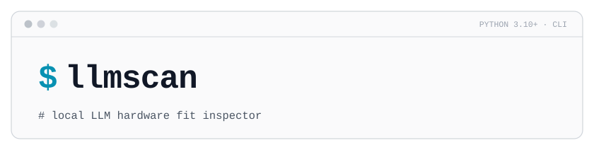
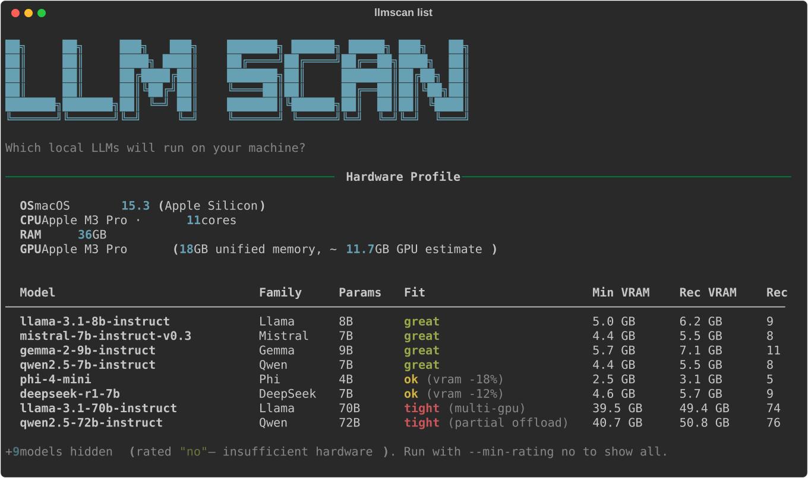

<div align="center">
  <picture>
    <source media="(prefers-color-scheme: dark)" srcset="https://raw.githubusercontent.com/adityaarakeri/llmscan/main/assets/hero-dark.svg" />
    <source media="(prefers-color-scheme: light)" srcset="https://raw.githubusercontent.com/adityaarakeri/llmscan/main/assets/hero-light.svg" />
    
  </picture>

  <p><strong>Scan your hardware and see which local LLMs fit before downloading gigabytes of weights.</strong></p>

  <p>
    <a href="#quickstart">Quickstart</a> &middot;
    <a href="#commands">Commands</a> &middot;
    <a href="#how-scoring-works">Scoring</a> &middot;
    <a href="#supported-hardware">Hardware</a> &middot;
    <a href="#development">Development</a>
  </p>

  <p>
    <a href="https://github.com/adityaarakeri/llmscan/actions/workflows/ci.yml"></a>
    <a href="https://pypi.org/project/llmscan/"></a>
    <a href="https://pypi.org/project/llmscan/"></a>
    <a href="https://github.com/adityaarakeri/llmscan/blob/main/LICENSE"></a>
  </p>
</div>

<div align="center">
  
</div>

## Quickstart

Requires **Python 3.10+** (or [uv](https://docs.astral.sh/uv/), which fetches Python automatically).

```bash
# Run once with zero install
uvx llmscan

# Or install globally (`llmscan` and short alias `llmc`)
uv tool install llmscan
llmscan
```

Running `llmscan` with no arguments prints your detected hardware profile and every bundled model rated `ok` or better.

<details>
<summary>Other install methods (pip, pipx, installing uv)</summary>

```bash
# pip / pipx
pip install llmscan
pipx install llmscan

# Upgrade or uninstall a uv tool install
uv tool upgrade llmscan
uv tool uninstall llmscan
```

Need `uv` first?

```bash
# macOS / Linux
curl -LsSf https://astral.sh/uv/install.sh | sh

# Windows (PowerShell)
powershell -ExecutionPolicy ByPass -c "irm https://astral.sh/uv/install.ps1 | iex"

# Homebrew or pipx
brew install uv
pipx install uv
```

</details>

<details>
<summary><strong>Table of Contents</strong></summary>

- [Why llmscan?](#why-llmscan)
- [Commands](#commands)
- [Common Workflows](#common-workflows)
- [How Scoring Works](#how-scoring-works)
- [Supported Hardware](#supported-hardware)
- [Custom Catalogs](#custom-catalogs)
- [Limitations](#limitations)
- [Development](#development)
- [License](#license)

</details>

## Why llmscan?

Pulling a 15-40 GB GGUF only to watch your runtime spill into swap or crash with OOM wastes time and bandwidth. `llmscan` probes your CPU, RAM, and GPUs (single or multi-GPU) in under a second, then scores 45 bundled models across 12 families against your actual inference backend (`llama.cpp`, Ollama, or MLX).

## Commands

Both `llmscan` and the short alias `llmc` invoke the same CLI.

| Command | Purpose | Key Flags |
| :--- | :--- | :--- |
| `llmscan` | Hardware snapshot + `ok` and `great` fits | `--plain`, `--no-color` |
| `llmscan scan` | Inspect OS, CPU, RAM, and GPU profile | `--json` |
| `llmscan list` | Score catalog models against this machine | `--min-rating`, `--family`, `--sort`, `--backend`, `--running`, `--json`, `--csv` |
| `llmscan explain <id>` | Break down why one model fits or fails | `--catalog` |
| `llmscan search <query>` | Search Hugging Face for GGUF repos | `--limit`, `--min-params`, `--max-params`, `--json` |
| `llmscan add <spec>` | Add a custom model or HF repo with auto VRAM | `--params-b`, `--quant`, `--family`, `--notes`, `--dry-run`, `--force`, `--json` |
| `llmscan remove <id>` | Remove a user-added model from local catalog | — |
| `llmscan doctor` | Check GPU detection tools and flag anomalies | `--json` |
| `llmscan catalog update` | Sync latest model catalog from remote JSON | `--dry-run`, `--url`, `--json` |
| `llmscan version` | Print installed version | `--check` (checks PyPI) |

## Common Workflows

### Filter by family, backend, or Ollama status

```bash
# Score models with Ollama's memory overhead and mark currently pulled models
llmscan list --backend ollama --running

# Focus on one family, sorted by minimum VRAM
llmscan list --family Qwen --sort vram --min-rating great

# Export machine-readable output for scripts or spreadsheets
llmscan list --json
llmscan list --csv > fits.csv
```

### Explain a single fit decision

```bash
llmscan explain llama-3.1-8b-instruct
llmscan explain qwen2.5-72b-instruct
```

### Search Hugging Face and add any GGUF

`llmscan add` derives `min_vram_gb`, `recommended_vram_gb`, and `recommended_ram_gb` from parameter count and quantization (25 quant tiers supported, including the full `IQ1_S` through `IQ4_NL` family). Set `HF_TOKEN` if you need access to gated repos or higher Hugging Face rate limits.

```bash
# Search Hugging Face GGUF repos in a parameter range
llmscan search llama --min-params 7 --max-params 13 --limit 5

# Auto-detect params and quant from a Hugging Face repo
llmscan add TheBloke/Llama-2-7B-GGUF

# Or preview a manual entry without writing to ~/.llmscan/catalog.json
llmscan add my-finetune --params-b 8 --quant IQ4_XS --family Llama --dry-run
```

### Diagnose detection issues or refresh the catalog

```bash
# Verify which vendor tools (nvidia-smi, rocm-smi, xpu-smi, sysctl, etc.) are found
llmscan doctor

# Preview remote catalog additions/updates without overwriting custom models
llmscan catalog update --dry-run
```

<details>
<summary>Full CLI flag reference, global flags, and supported quantizations</summary>

#### Global flags (place before the subcommand)

| Flag | Description |
| :--- | :--- |
| `--no-color`, `--plain` | Strip ANSI colors and Rich formatting (for CI and log capture) |
| `--version`, `-V` | Print version and exit |
| `--install-completion <shell>` | Install shell completion (`bash`, `zsh`, or `fish`) |
| `--show-completion <shell>` | Print the completion script for `bash`, `zsh`, or `fish` |

```bash
llmscan --plain list --min-rating no
llmscan --install-completion zsh
```

#### Subcommand examples

```bash
# Hardware inspection
llmscan scan --json

# Model listing
llmscan list --min-rating no                 # include non-fits
llmscan list --sort params                   # rating | params | vram | name
llmscan list --backend mlx                   # llama-cpp | ollama | mlx
llmscan list --catalog my_models.json

# Model explanation
llmscan explain my-model --catalog my_models.json

# Local catalog management
llmscan add my-model --params-b 7 --quant Q4_K_M --family Llama --notes "My fine-tune"
llmscan add my-model --params-b 7 --quant Q8_0 --family Llama --force
llmscan remove my-model                      # removes user-added entries only

# Remote catalog & version checks
llmscan catalog update --url https://example.com/catalog.json --json
llmscan version --check
```

#### Supported quantization types (25)

- **iMatrix (IQ):** `IQ1_S`, `IQ1_M`, `IQ2_XXS`, `IQ2_XS`, `IQ2_S`, `IQ2_M`, `IQ3_XXS`, `IQ3_XS`, `IQ3_S`, `IQ3_M`, `IQ4_XS`, `IQ4_NL`
- **K-quants & standard:** `Q2_K`, `Q3_K_S`, `Q3_K_M`, `Q3_K_L`, `Q4_0`, `Q4_K_S`, `Q4_K_M`, `Q5_0`, `Q5_K_S`, `Q5_K_M`, `Q6_K`, `Q8_0`, `F16`

</details>

## How Scoring Works

Each model receives a fit rating plus a parenthetical reason code when there is a caveat (for example `ok (vram -22%)` or `tight (multi-gpu)`).

| Rating | Meaning |
| :--- | :--- |
| `great` | Single-GPU VRAM and system RAM both meet recommended targets |
| `ok` | Clears minimums; may need modest context limits, multi-GPU, or CPU-only RAM |
| `tight` | Needs partial/CPU offload, reduced context, or multi-GPU minimum splitting |
| `no` | Below practical memory minimums |

### Backend Overhead Multipliers

Pass `--backend` to match the runtime you actually plan to use. JSON output always records the active `"backend"`.

| Backend | VRAM Overhead | RAM Overhead | Notes |
| :--- | :--- | :--- | :--- |
| `llama-cpp` | Baseline | Baseline | Default calibration target |
| `ollama` | +15% | +10% | Accounts for default context window and serving overhead |
| `mlx` | +10% | Baseline | Apple Silicon MLX framework headroom |

When Ollama is running locally, `llmscan list --running` queries `http://localhost:11434/api/tags` and marks models already available in Ollama (adding `"running": true/false` to `--json` output).

<details>
<summary>Reason codes reference</summary>

| Reason Code | When It Appears |
| :--- | :--- |
| *(none)* | `great` or `no` |
| `vram -N%` | GPU clears minimum VRAM but sits N% below recommended VRAM |
| `ram low` | GPU meets recommended VRAM, but system RAM is the bottleneck |
| `cpu-only` | No usable GPU; inference runs entirely in system RAM |
| `multi-gpu` | Fit relies on combining VRAM across multiple GPUs |
| `partial offload` | GPU holds most layers; remainder offloads to CPU |
| `cpu offload` | GPU is too small for most layers; CPU carries the bulk of inference |

</details>

## Supported Hardware

| Platform / Vendor | Detection Method | Notes |
| :--- | :--- | :--- |
| NVIDIA | `nvidia-smi` | Discrete CUDA GPUs (single and multi-GPU) |
| AMD | `rocm-smi` | ROCm-supported GPUs |
| Intel | `xpu-smi`, `clinfo` | Intel Arc and Data Center GPUs |
| Apple Silicon | `sysctl` | Unified memory (65% estimated usable GPU share) |
| Windows | `Get-CimInstance`, `wmic` | Generic fallback for Windows video adapters |

> [!NOTE]
> **WSL2:** `llmscan` detects WSL2 automatically and warns that `nvidia-smi` VRAM readings inside WSL2 can diverge from the Windows host. Verify GPU memory on the host if numbers look unexpected.

## Custom Catalogs

Models added via `llmscan add` or `llmscan catalog update` are stored in `~/.llmscan/catalog.json` and merged over the 45 bundled models. If the file is malformed, `llmscan` warns on stderr and falls back to the bundled catalog.

You can also pass any standalone JSON file with `--catalog`:

```bash
llmscan list --catalog my_models.json
llmscan explain my-custom-model-7b --catalog my_models.json
```

<details>
<summary>Custom catalog JSON schema and required fields</summary>

```json
[
  {
    "id": "my-custom-model-7b",
    "family": "Custom",
    "params_b": 7,
    "quant": "Q4_K_M",
    "min_vram_gb": 5,
    "recommended_vram_gb": 8,
    "recommended_ram_gb": 16,
    "notes": "My fine-tuned model"
  }
]
```

| Field | Type | Description |
| :--- | :--- | :--- |
| `id` | string | Unique lowercase model identifier |
| `family` | string | Model family name (e.g. `Llama`, `Qwen`, `Mistral`) |
| `params_b` | number | Parameter count in billions |
| `quant` | string | Quantization format (e.g. `Q4_K_M`, `IQ4_XS`) |
| `min_vram_gb` | number | Minimum GPU VRAM in GB |
| `recommended_vram_gb` | number | Recommended GPU VRAM in GB |
| `recommended_ram_gb` | number | Recommended system RAM in GB |
| `notes` | string | Short description shown in `explain` |

</details>

## Limitations

- **Estimates, not live benchmarks:** `llmscan` predicts memory fit from parameter count, quantization bits-per-weight, and backend multipliers. It does not load weights or measure actual tokens/sec.
- **Apple Silicon heuristic:** macOS unified memory is estimated at 65% available to GPU workloads, which varies if you adjust `iogpu.wired_limit_mb` or run heavy desktop apps.
- **MoE models:** Mixture-of-Experts models (such as Mixtral 8x7B or DeepSeek-V3) must still fit all weights in memory, so scoring uses total parameter count rather than active parameters.

## Development

The project is managed with [uv](https://docs.astral.sh/uv/) (`uv.lock` pins all dependencies and `.python-version` sets the default Python).

```bash
git clone https://github.com/adityaarakeri/llmscan.git
cd llmscan
uv sync                 # create .venv with editable install + pytest, ruff, mypy
uv run llmscan scan     # run from your working copy
```

Run the full CI check suite locally with `make`:

```bash
make            # lint + typecheck + test (same as `make ci`)
make lint       # ruff check + ruff format --check
make format     # auto-format with ruff
make typecheck  # mypy llmscan/
make test       # pytest
```

Override the Python version with `make PYTHON=3.10 ci`. Always commit `uv.lock` alongside `pyproject.toml` changes; CI runs with `--locked`.

Bug reports and PRs are welcome. Run `make` before opening a pull request so lint, typecheck, and tests stay green.

## License

MIT. See [LICENSE](https://github.com/adityaarakeri/llmscan/blob/main/LICENSE) for details.
